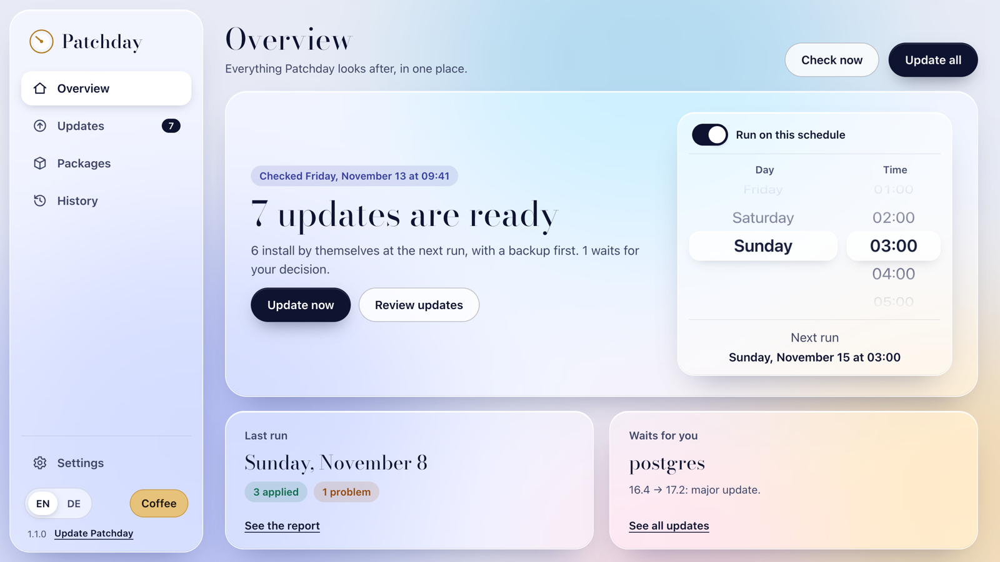
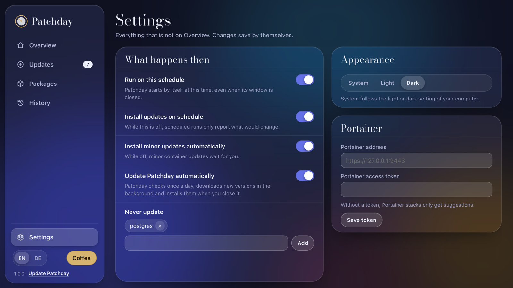
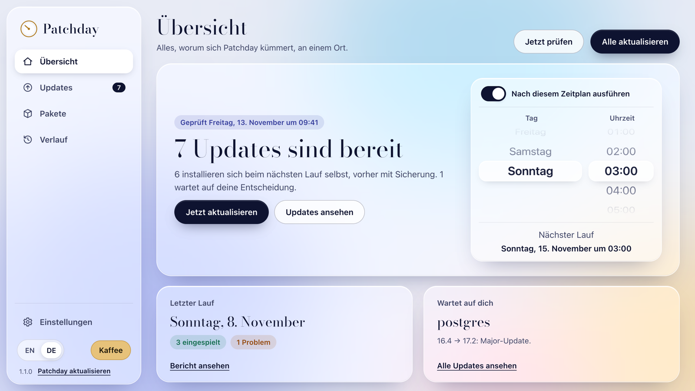
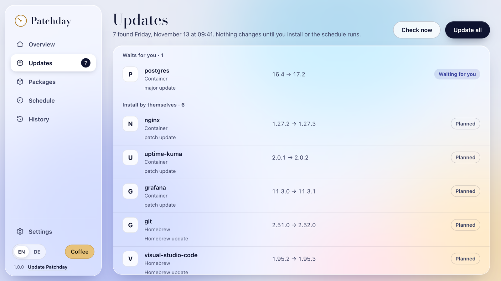
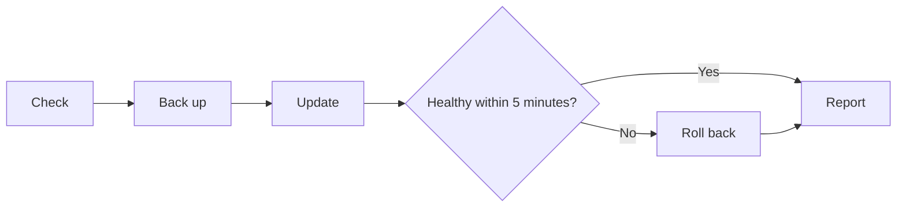
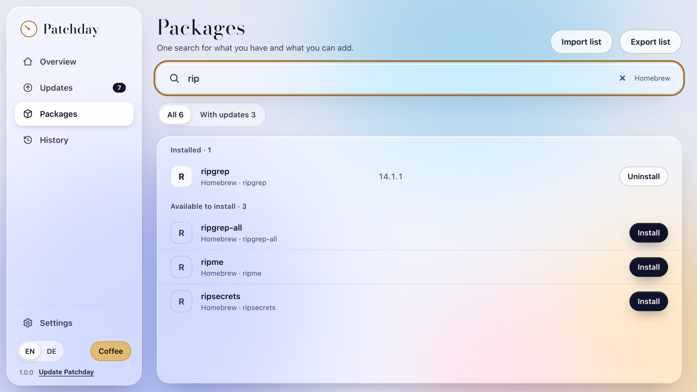

<p align="center">
  
</p>

<h1 align="center">Patchday</h1>

<p align="center">
  Scheduled, rule-based updates for Homebrew, winget, Chocolatey, Scoop and Docker, with a backup first, a health check after, and a rollback if anything fails. Find, install and remove packages in one place.
</p>

<p align="center">
  
  
  
  <a href="https://ko-fi.com/kvnbe"></a>
</p>

<p align="center">
  
</p>

<p align="center"><sub>Screenshots use sample data.</sub></p>

> [!WARNING]
> Patchday is an early preview. Real update runs have not been tested widely yet. Use **Check now** first, and turn on automatic installs only after you have read the [rules](#the-rules).

## Contents

- [What it does](#what-it-does)
- [Install](#install)
- [Get started](#get-started)
- [How a run works](#how-a-run-works)
- [The rules](#the-rules)
- [Manage packages](#manage-packages)
- [Docker and Portainer](#docker-and-portainer)
- [Settings](#settings)
- [Your data](#your-data)
- [Troubleshooting](#troubleshooting)
- [Build from source](#build-from-source)
- [Project structure](#project-structure)
- [Known limits](#known-limits)
- [Support](#support)
- [License](#license)

## What it does

- **Pick your own time.** Turn two wheels on Overview: the day and the hour of the weekly run.
- **See changes before they happen.** **Check now** lists every update and changes nothing.
- **Update packages.** Homebrew on macOS, winget, Chocolatey and Scoop on Windows.
- **Manage packages.** See everything installed, search all package managers at once, and install, update or remove several packages in one go.
- **Skip or ignore updates.** Skip one version of a package, or ignore its updates until you allow them again.
- **Move to a new computer.** Export your package list and import it on another machine.
- **Look back.** The history keeps the last 1000 installs, updates, removals and runs.
- **Update Docker containers.** Patchday finds Compose stacks by itself and works with Portainer if you use it.
- **Stay in control.** Risky updates become suggestions that wait for your decision.
- **Recover from bad updates.** A stack that does not come back healthy returns to its old version.
- **Watch it happen.** Every update shows its steps as they happen, and failures show a short reason.
- **Fix failures by itself.** A failed install is repaired step by step: retry, refresh, and finally a fresh install. It stops only where that cannot help, such as missing rights or an app that is still running.
- **Find out why.** **Export logs** saves every run with the reason and the tool's own output for each failed update.
- **Update itself.** Patchday checks once a day, downloads a new version in the background and installs it when you close it. You can turn this off.
- **Allow admin rights once.** On Windows, one confirmation replaces a prompt for every app.
- **Easy to find your way.** A sidebar with four places and Settings, and every page built the same way.
- **Light or dark.** Layered glass in both, following your system or your choice.
- **English and German.**

<p align="center">
  
  
</p>

## Install

Download the latest version from the [Releases page](https://github.com/kvn-be/patchday/releases), or [build Patchday yourself](#build-from-source).

### Windows

1. Download and run `Patchday-Setup-1.0.0.exe`.
2. If Windows shows "Windows protected your PC", select **More info**, then **Run anyway**. The warning appears because the app is not signed yet.
3. Follow the installer and start Patchday.
4. On first start, select **Allow once** and confirm the Windows prompt. Patchday creates a task that installs updates without asking again. You can do this later in **Settings**.

### macOS

1. Download and open `Patchday-1.0.0-arm64.dmg` for Apple silicon, or `Patchday-1.0.0-x64.dmg` for Intel Macs.
2. Drag Patchday to **Applications**.
3. Start it. macOS blocks unsigned apps, so go to **System Settings > Privacy & Security** and select **Open Anyway**.

### Homebrew

A Homebrew tap is planned but not available yet.

## Get started

1. On **Overview**, select **Check now**. Patchday lists what would change, and nothing is installed.
2. Open **Updates** and read the list. **Planned** would run automatically, **Waiting for you** would not.
3. On **Overview**, turn the **Day** and **Time** wheels to when the weekly run should start. Night hours from 00:00 to 06:00 are safest.
4. Turn on **Run on this schedule**. Scheduled runs now report what would change.
5. When you trust the results, open **Settings** and turn on **Install updates on schedule**.

To update right away, select **Update all** and confirm. Containers and apps may restart.

<p align="center">
  
</p>

| Status | Meaning |
| --- | --- |
| Planned | Would be installed by a real run. Only shown in previews. |
| Applied | Installed and confirmed. |
| Waiting for you | Not installed. The line below it says why. |
| Rolled back | Installed, failed the health check, and returned to the old version. |
| Failed | Could not be completed. The line below it names the next step. |

## How a run works



1. **Check.** Lists running containers, looks up newer image tags, and lists outdated packages.
2. **Back up.** Saves the stack file and dumps PostgreSQL databases in that stack. If a backup fails, that stack is not updated.
3. **Update.** One stack at a time. Docker runtimes such as OrbStack are updated last.
4. **Test.** Waits up to 5 minutes until every updated container runs the new image and stays healthy.
5. **Report.** Saves the result and shows a notification after scheduled runs.

## The rules

Patchday uses fixed rules and no AI. A container only updates automatically if every condition is met.

| Runs automatically | Suggestion only | Never |
| --- | --- | --- |
| Patch updates of healthy containers | Major updates | Delete volumes or databases |
| Homebrew, winget, Chocolatey and Scoop packages | Databases and caches | `docker system prune` |
| Minor updates with release notes that show no breaking changes (see [Known limits](#known-limits)) | Network and DNS services such as `cloudflared` | Change a stack behind Portainer's back |
| | Portainer itself, locally built images, prerelease tags | |
| | Unhealthy containers and images without a build for your CPU | |
| | Anything on your **Never update** list | |

Image tags keep their scheme: `1.2.3-alpine` only moves to another `-alpine` tag.

## Manage packages

<p align="center">
  
</p>

A sidebar leads to **Overview**, **Updates**, **Packages** and **History**, with **Settings** at its foot. Every page has its title, one sentence on what it does, and its main action at the top right.

| Page | What you can do |
| --- | --- |
| Overview | See how many updates are ready. Turn the schedule on or off, pick its day and time and see the date of the next run, all in one box. Below: the last run and what waits for your decision. |
| Updates | The latest check or run, grouped into what waits for you, problems, what installs by itself and what was applied. |
| Packages | One search for both: installed packages first, packages you can add below. Update, skip a version or uninstall right in the row. |
| Settings | Choose what happens at a run, keep the **Never update** list, pick light, dark or system appearance, and connect Portainer. |
| History | The last 1000 installs, updates, removals and runs, with the tool's message for failures. **Export logs** saves all of it as a text file. |

- **Skip** hides one version of a package. The next newer version shows up again.
- **Never update** in **Settings** leaves a package or image alone, in the package list and in scheduled runs.
- **Export list** saves your installed packages as a JSON file. **Import list** reads such a file and lists the packages that are not installed yet, ready to install. Entries this system cannot install are left out and counted.

Installs and removals you start yourself run in your own user account, never through the admin task. On Windows, installers may ask for admin rights, and Chocolatey always does.

## Docker and Portainer

**Compose.** Patchday reads the Compose labels of running containers, edits the `image:` line in the stack file and runs `docker compose up -d`. Comments and layout in the file stay as they are.

**Portainer.** Stacks owned by Portainer are only changed through its API.

1. In Portainer, open **My account** and create an access token.
2. In Patchday, open **Settings** and enter the address, for example `https://127.0.0.1:9443`.
3. Paste the token and select **Save token**.

While Portainer is running and no token is saved, stacks that might belong to it only get suggestions. Self-signed certificates are accepted for local addresses only. Stacks deployed from Git are never changed.

## Settings

| Setting | Default | Effect |
| --- | --- | --- |
| Run on this schedule | Off | Registers the run with launchd on macOS or Task Scheduler on Windows. |
| Install updates on schedule | Off | While off, scheduled runs only report. |
| Install minor updates automatically | On | While off, minor updates of containers are suggestions. |
| Update Patchday automatically | On | Checks once a day, downloads in the background and installs when you close Patchday. |

The schedule switch, day and time are on **Overview**. Everything else is on the **Settings** page, along with the appearance, the Portainer connection and, on Windows, the admin access.
| Never update | Empty | Names of images or packages to leave alone, separated by commas. |
| Portainer address and token | Empty | Connects Portainer stacks. |

Language is at the bottom of the sidebar.

## Your data

Patchday has no account and no telemetry. Everything stays on your computer:

| Item | macOS | Windows |
| --- | --- | --- |
| App data | `~/Library/Application Support/Patchday` | `%APPDATA%\Patchday` |

Inside that folder:

- `settings.json`: your settings, including skipped versions.
- `history.json`: the last 1000 installs, updates, removals and runs.
- `reports/`: one file per run.
- `logs/`: the log book behind **Export logs**, about 1 MB plus one older file.
- `backups/`: stack files and database dumps, one folder per stack update. These may contain sensitive data. After each run, folders older than 30 days are removed, but the 10 newest always stay. Folders you add by hand are never touched.
- `portainer.token`: your token, encrypted by the operating system.

To find updates, Patchday sends image names to Docker Hub and other public registries, and asks GitHub for its own latest version.

## Troubleshooting

| Problem | Fix |
| --- | --- |
| macOS says the app is damaged | Run `xattr -dr com.apple.quarantine /Applications/Patchday.app` |
| The report says `Docker is not reachable` | Start Docker, then select **Check now** again. |
| A stack shows `Portainer is not connected` | Add the address and token in **Settings**. |
| A stack shows `not managed by Compose or Portainer` | Portainer is running and no token is saved, or the container was started without Compose. |
| A package shows **Failed** | The line below it names the cause, for example `app is running, close it`. **Show details** has the tool's own message, and **Export logs** on **History** collects it for every update. |
| `download did not match its checksum` | Patchday has already cleared the download, refreshed the sources and installed fresh. If it still fails, the publisher's file differs from what the package manager expects; checks are never skipped. Try again later. |
| On macOS, a cask shows `needs your admin password` | Patchday does not store your password. Run `brew upgrade --cask <name>` once in the terminal. |
| A stack shows **Failed** after a rollback | Restore the stack from the backup path shown in the report. |
| A scheduled run did not start | The computer must be awake and you must be logged in. |

## Build from source

You need Node.js 22.18 or newer.

```sh
git clone https://github.com/kvn-be/patchday.git
cd patchday
npm ci
npm start
```

| Command | What it does |
| --- | --- |
| `npm start` | Builds and starts the app. Development builds never register a schedule. |
| `npm test` | Runs the tests. The manual checklist for real machines is in [docs/testing.md](docs/testing.md). |
| `npm run typecheck` | Checks the TypeScript types. |
| `npm run scan` | Prints containers and outdated packages in the terminal, read-only. |
| `npm run dist:mac` | Creates the `.dmg` files in `release/`. |
| `npm run dist:win` | Creates the `.exe` installer in `release/`. |

Starting the **Build** workflow on GitHub, or pushing a tag like `v0.1.0`, builds both platforms.

## Project structure

```text
src/
  core/       Pure rules: versions, policy, schedules, parsers
  engine/     Update runs, registries, Portainer client
  main/       Electron main process and system scheduler
  renderer/   The user interface
  cli/        Read-only scan command
design/       Design system
scripts/      Build script
```

## Known limits

- Release notes are not fetched yet, so minor container updates stay suggestions.
- There is no vulnerability scan or log analysis yet.
- Old images are not removed after updates.
- Builds are not signed, so both systems show a warning.
- Versions before 0.2.0 cannot update themselves, so install 0.2.0 by hand once.
- Scheduled runs on Windows, the admin task and winget support have had little real-world testing.
- Homebrew, winget, Chocolatey and Scoop report no percentage, so their bars show activity until a package is finished.
- Scoop and the **Packages** page on Windows have had little real-world testing.
- Package details such as publisher, download size or install options, and installing a specific older version, are not available yet.
- With the admin task set up, scheduled runs also update Scoop apps with admin rights. Scoop warns about that but works.
- Some installers refuse to run as administrator. They show that as the reason.

## Support

Patchday is free. If it saves you work, you can [buy me a coffee](https://ko-fi.com/kvnbe).

Changes per version are in the [changelog](CHANGELOG.md). To report a vulnerability, see [SECURITY.md](SECURITY.md).

## License

[MIT](LICENSE)
